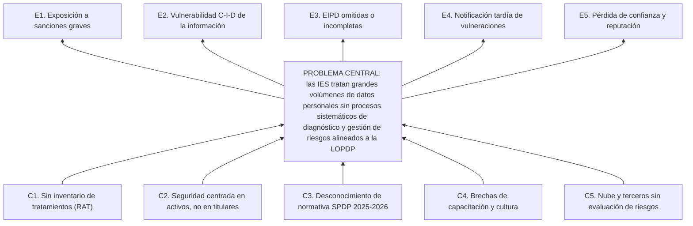

# CAPÍTULO I. INTRODUCCIÓN

El presente trabajo de integración curricular aborda el tema *Metodología para el diagnóstico y gestión de riesgos en el tratamiento de datos personales*, circunscrito a los datos personales de estudiantes y docentes que tratan las instituciones de educación superior (IES) ecuatorianas en el marco de la Ley Orgánica de Protección de Datos Personales (LOPDP). El capítulo sigue la estructura de la plantilla institucional de la Universidad Tecnológica Indoamérica (UTI): contextualización, estado del arte, planteamiento del problema, justificación, objetivos, alcance y fundamentación teórica.

## 1.1 Contextualización

### Contexto macro: la exposición del sector educativo a nivel mundial

La educación superior se ha consolidado como uno de los sectores con mayor exposición a incidentes que comprometen datos personales. La edición 2024 del estudio *The State of Ransomware in Education*, basada en una encuesta a 5 000 responsables de tecnología de 14 países, de los cuales 600 pertenecían a organizaciones educativas, reportó que el 66 % de las IES había sufrido un ataque de *ransomware* en el último año, que el 77 % de esos ataques terminó con el cifrado de datos y que el costo medio de recuperación en el subsector alcanzó 4,02 millones de dólares (Sophos, 2024). Estas cifras ubican a las universidades por encima del promedio intersectorial y muestran que el problema no se limita a la disponibilidad de los sistemas, sino que afecta de forma directa la confidencialidad de los registros de estudiantes y docentes.

La literatura académica coincide en ese diagnóstico. La revisión de Ulven y Wangen (2021) sintetizó los activos críticos, eventos de amenaza y vulnerabilidades frecuentes en la educación superior, concluyó en nueve riesgos estratégicos de ciberseguridad para el sector y advirtió que ya se han producido brechas de datos graves que probablemente se repetirán sin una gestión de riesgos adecuada; los autores señalan, además, que la investigación empírica sobre riesgos en este sector es escasa y presenta vacíos importantes. En la misma línea, Li et al. (2023) partieron de que los entornos digitales universitarios, complejos y dinámicos, son altamente vulnerables a brechas de datos y, con una muestra de universidades chinas, encontraron que la divulgación pública de vulnerabilidades incrementa la frecuencia de brechas, mientras que la adopción de servicios en la nube la reduce; es decir, la exposición depende de decisiones de gestión sobre vulnerabilidades y plataformas, lo que refuerza la necesidad de un enfoque de gestión de riesgos y no solo de controles técnicos puntuales.

El crecimiento de las plataformas digitales de aprendizaje amplía la superficie de tratamiento. Liu y Khalil (2023), en una revisión sistemática sobre analítica del aprendizaje, identificaron ocho problemas interrelacionados de privacidad y protección de datos a lo largo del ciclo de vida de esos datos, desde la recolección hasta la explotación de resultados. Por su parte, Fernandes et al. (2022) estudiaron la implementación del Reglamento General de Protección de Datos (RGPD) en universidades públicas portuguesas y determinaron dieciséis factores críticos de éxito, entre los que destacan el compromiso de la alta dirección y la cultura organizacional de protección de datos; su hallazgo sugiere que, incluso en jurisdicciones con larga tradición normativa, la adecuación de las IES depende más de la gestión que de la tecnología disponible.

### Contexto meso: América Latina y Ecuador

En América Latina, los incidentes en universidades han pasado de ser casos aislados a eventos con consecuencias públicas visibles. En marzo de 2023, la Universidad Nacional de Colombia sufrió un ataque de *ransomware* que cifró parte de su información y obligó a aislar sus sistemas financiero, académico y de talento humano mientras se restablecían los servicios (Semana, 2023). En octubre de 2024, la Universidad Técnica Federico Santa María, en Chile, registró un incidente atribuido al grupo RansomHub, tras el cual se publicaron en la *dark web* alrededor de 14 GB de información que incluía listados de estudiantes con su número de identificación, carrera y año de ingreso, así como datos de deudores del fondo de crédito estudiantil (CNN Chile, 2024). En el ámbito académico, Zappelini et al. (2023) mostraron que, en Brasil, el uso de medios digitales para la docencia y la evaluación remota en IES plantea riesgos específicos cuando los titulares son adolescentes, situación análoga al régimen de categorías especiales que establece la normativa ecuatoriana.

Ecuador cuenta con un antecedente nacional que evidenció la magnitud del problema antes de la existencia de una ley específica. En septiembre de 2019 se reportó la exposición de una base de datos de una empresa privada de mercadeo y analítica que contenía información de alrededor de 20 millones de personas, incluidos cerca de 6,7 millones de niños, con campos como nombres, fecha de nacimiento, domicilio, teléfonos y nivel de educación (Arciniegas, 2019). Ese caso aceleró el debate legislativo que culminó con la expedición de la LOPDP, publicada en el Quinto Suplemento del Registro Oficial N.º 459 el 26 de mayo de 2021 (Asamblea Nacional del Ecuador, 2021). Su reglamento general fue expedido mediante el Decreto Ejecutivo N.º 904 y publicado en el Tercer Suplemento del Registro Oficial N.º 435 el 13 de noviembre de 2023 (Presidencia de la República del Ecuador, 2023).

La LOPDP establece obligaciones que inciden directamente en la gestión de riesgos. El artículo 37 exige al responsable identificar la probabilidad de riesgos e implementar un proceso de verificación, evaluación y valoración continua de las medidas de seguridad; el artículo 40 obliga a utilizar una metodología de análisis de riesgos, amenazas y vulnerabilidades que considere las particularidades del tratamiento, de las partes involucradas y las categorías y volumen de datos; y el artículo 42 vuelve obligatoria la evaluación de impacto cuando exista tratamiento a gran escala de categorías especiales de datos (Asamblea Nacional del Ecuador, 2021, arts. 37, 40 y 42). A ello se suma la obligación de notificar las vulneraciones de seguridad a la autoridad en el término de cinco días (art. 43). La Disposición Transitoria Primera difirió por dos años la vigencia del régimen sancionatorio, con lo que el periodo de adecuación concluyó en 2023 (Asamblea Nacional del Ecuador, 2021).

La Superintendencia de Protección de Datos Personales (SPDP) comenzó a emitir normativa técnica entre 2025 y 2026. Mediante la Resolución N.º SPDP-SPD-2025-0003-R, del 29 de abril de 2025, publicada en el Cuarto Suplemento del Registro Oficial N.º 41 el 19 de mayo de 2025, expidió la *Guía de Gestión de Riesgos y Evaluación de Impacto del Tratamiento de Datos Personales*, cuyo capítulo I es de cumplimiento obligatorio y cuyo capítulo II ofrece metodologías referenciales (Superintendencia de Protección de Datos Personales [SPDP], 2025; Lexis, 2025); posteriormente, mediante la Resolución N.º SPDP-SPD-2026-0012-R, publicada en el Suplemento del Registro Oficial N.º 254 el 30 de marzo de 2026, expidió la segunda versión (V.2) de la guía (SPDP, 2026a). Asimismo, la Resolución N.º SPDP-SPD-2026-0005-R, publicada en el Suplemento del Registro Oficial N.º 231 el 25 de febrero de 2026, definió el Modelo Técnico de Gran Escala y estableció que constituyen tratamiento a gran escala, de forma directa, los tratamientos relativos a la salud y a otras categorías especiales, así como el tratamiento sistemático de datos de niñas, niños y adolescentes en entornos educativos; esa calificación vuelve obligatorias la evaluación de impacto previa y la designación de un delegado de protección de datos (SPDP, 2026b, arts. 12 y 14).

La autoridad ya ha ejercido su potestad sancionadora. El 1 de diciembre de 2025 se dieron a conocer las primeras sanciones por infracciones graves de la LOPDP, impuestas a la Liga Profesional de Fútbol del Ecuador y a la Federación Ecuatoriana de Fútbol por un total cercano a 454 500 dólares, con fundamento en el artículo 68 de la ley y por no implementar medidas administrativas, técnicas y físicas suficientes para garantizar un tratamiento adecuado (Revelo, 2025; ECIJA GPA, 2025). Aunque ninguno de esos casos corresponde a una IES, demuestran que las obligaciones de la ley son exigibles. Debe subrayarse, además, que el mismo artículo 68 tipifica como infracción grave del responsable, en su numeral 4, no utilizar metodologías de análisis y gestión de riesgos adaptadas a la naturaleza de los datos personales, a las particularidades del tratamiento y a las partes involucradas (Asamblea Nacional del Ecuador, 2021, art. 68), de modo que la ausencia de una metodología constituye, por sí misma, una conducta sancionable. La aplicación de este régimen es reciente: hasta septiembre de 2025 la SPDP había recibido 191 denuncias sin haber impuesto sanción alguna, porque la ley prevé que ante una infracción grave se ordenen primero medidas correctivas y solo se sancione si estas no se cumplen (Almeida y Mena, 2025). En las fuentes públicas consultadas no se identificó, a la fecha de redacción, un procedimiento sancionador contra una IES, por lo que para estas instituciones el riesgo jurídico se mantiene latente y aún no se ha materializado.

### Contexto micro: las IES ecuatorianas y la unidad de análisis

En el sistema de educación superior ecuatoriano, la evidencia disponible indica que la adecuación a la LOPDP es heterogénea. Álvarez-Carrión y Hernández-Sotomayor (2024) analizaron la protección de datos en plataformas educativas digitales y concluyeron que, aunque la ley ofrece un marco sólido, su implementación enfrenta brechas de infraestructura y de capacitación en ciberseguridad; al revisar vulneraciones documentadas en universidades del país, identificaron los fallos técnicos y el error humano como causas principales. Piray Rodríguez et al. (2026), mediante revisión documental y análisis normativo, encontraron diferencias marcadas entre instituciones en la adopción de políticas internas de protección de datos y observaron que solo un número limitado de universidades las aplica de manera destacada. A nivel de gestión de riesgos, López-Vasco et al. (2025) documentaron la aplicación de ISO/IEC 27001 en institutos tecnológicos de educación superior del Ecuador, lo que constituye un antecedente de diagnóstico y planificación de controles en el sector, aunque centrado en la seguridad de la información y no en los derechos de los titulares.

La unidad de análisis de este trabajo se ubica en la UTI, institución de educación superior particular con sede en Quito, cuya Facultad de Ingenierías propone el presente tema. Las IES tratan datos de estudiantes, aspirantes, graduados, docentes y personal administrativo en procesos como admisión y matrícula, registro de calificaciones, becas, bienestar estudiantil, aula virtual y titulación; varios de esos procesos involucran categorías especiales en los términos del artículo 25 de la LOPDP, como datos de salud, de discapacidad o de adolescentes que ingresan a la universidad (Asamblea Nacional del Ecuador, 2021, art. 25). La unidad o proceso específico que servirá de caso de estudio se definirá con la tutoría, y toda información institucional se tratará de forma anonimizada o agregada, sin datos personales reales ni identificación de funcionarios.

## 1.2 Estado del arte

La revisión de antecedentes se realizó en bases de datos académicas (IEEE Xplore, ScienceDirect, SpringerLink, Scopus, SciELO y Google Académico) y en los sitios oficiales de autoridades de protección de datos y de organismos de normalización. Se priorizaron publicaciones de 2019 en adelante, sin excluir los trabajos seminales, y solo se incluyeron fuentes con DOI o con publicación oficial verificable. Los criterios de inclusión fueron tres: que el trabajo propusiera o evaluara un método de gestión de riesgos o de evaluación de impacto sobre datos personales, que abordara el tratamiento de datos en instituciones de educación superior, o que aportara evidencia normativa o empírica del contexto latinoamericano y ecuatoriano. Los trabajos seleccionados se organizaron en cinco ejes: (1) marcos de referencia para la evaluación de impacto y el riesgo de privacidad; (2) métodos de estimación del riesgo; (3) gestión de riesgos de seguridad de la información en el sector público y educativo; (4) protección de datos personales en IES, y (5) antecedentes latinoamericanos y ecuatorianos. Las Tablas 1 y 2 resumen los trabajos académicos analizados y la Tabla 3 compara los principales marcos metodológicos con los requisitos de este proyecto.

**Tabla 1**
*Trabajos relacionados con los marcos, la estimación y la gestión de riesgos (ejes 1 a 3)*

| Eje | Trabajo | Enfoque y aporte | Limitación respecto de este proyecto |
|---|---|---|---|
| 1 | Deng et al. (2011) | Marco LINDDUN de modelado de amenazas a la privacidad con siete categorías y árboles de amenaza. | Orientado al diseño de software; no estima probabilidad ni impacto. |
| 1 | Bieker et al. (2016) | Proceso adaptable de EIPD derivado de los requisitos del RGPD. | Marco europeo; sin aplicación sectorial. |
| 1 | Vemou y Karyda (2020) | Comparación de métodos PIA de autoridades, normas y academia; criterios de buenas prácticas. | Criterios generales, sin aplicación a un caso. |
| 1 | Wairimu et al. (2024) | Revisión sistemática de metodologías PIA y PRA y de la forma en que se han evaluado. | No se centra en un sector ni en la normativa ecuatoriana. |
| 1 | Iwaya et al. (2024) | *Scoping review* sobre la aplicación práctica de las PIA/EIPD, sus beneficios y dificultades. | Evidencia mayoritariamente europea; no aborda IES. |
| 1 | Wairimu et al. (2025) | Percepción de profesionales sobre el uso de categorías de daño a la privacidad en la evaluación de riesgos. | No propone escalas de impacto aplicables a un sector. |
| 2 | Wang et al. (2020) | Implementación del modelo FAIR mediante redes bayesianas para estimar frecuencia y magnitud de pérdidas. | Perspectiva financiera del responsable; no considera el daño a titulares. |
| 3 | Patiño et al. (2018) | Metodología de gestión de riesgos TIC basada en ISO/IEC 27005 para entidades gubernamentales ecuatorianas. | Orientada a activos de información, no a derechos de titulares. |
| 3 | Ulven y Wangen (2021) | Revisión sistemática de riesgos de ciberseguridad en educación superior; nueve riesgos estratégicos. | Identifica riesgos, pero no define un proceso de gestión. |
| 3 | Li et al. (2023) | Factores que explican las brechas de datos en universidades chinas. | Análisis explicativo; no ofrece una metodología. |
| 3 | López-Vasco et al. (2025) | Diagnóstico y plan de controles ISO/IEC 27001 en institutos tecnológicos de Ecuador. | Enfoque de seguridad de la información; no integra la LOPDP. |

*Nota.* Elaboración propia a partir de las fuentes citadas.

**Tabla 2**
*Trabajos relacionados con la protección de datos personales en IES y antecedentes regionales (ejes 4 y 5)*

| Eje | Trabajo | Enfoque y aporte | Limitación respecto de este proyecto |
|---|---|---|---|
| 4 | Gursoy et al. (2017) | Técnicas de anonimización y privacidad diferencial para analítica del aprendizaje. | Controles técnicos aislados de un proceso de riesgos. |
| 4 | Habbabeh et al. (2019) | Instrumento de 44 controles para medir la alineación de una IES con el RGPD. | Mide cumplimiento, no riesgo; no distingue riesgo inherente y residual. |
| 4 | Vanezi et al. (2019) | Cumplimiento del RGPD desde el diseño en una plataforma de *e-learning*. | Limitado a una plataforma; no abarca la institución. |
| 4 | Tsai et al. (2020) | Expectativas y conductas de privacidad de estudiantes frente a la analítica del aprendizaje. | Estudio de percepción; no evalúa riesgos. |
| 4 | Fernandes et al. (2022) | Factores críticos de éxito para implementar el RGPD en universidades públicas. | Marco europeo; no propone una metodología de riesgos. |
| 4 | Liu y Khalil (2023) | Revisión sistemática de problemas de privacidad en el ciclo de vida de la analítica del aprendizaje. | Catálogo de problemas, sin valoración del riesgo. |
| 4 | Maguraushe et al. (2026) | Encuesta diagnóstica de conciencia, expectativas y confianza de estudiantes sobre privacidad. | Diagnóstico de percepción; no cubre procesos ni controles. |
| 5 | Guerrero Argote (2021) | Adopción de *e-proctoring* y riesgos para la privacidad en universidades de Argentina, Chile y Perú. | Estudio exploratorio; análisis jurídico preliminar. |
| 5 | Zappelini et al. (2023) | Datos de adolescentes en IES brasileñas bajo la LGPD; docencia y evaluación remota. | Análisis jurídico; sin método de riesgos. |
| 5 | Álvarez-Carrión y Hernández-Sotomayor (2024) | Protección de datos en plataformas educativas de IES ecuatorianas. | Diagnóstico normativo; no define un proceso de gestión de riesgos. |
| 5 | Piray Rodríguez et al. (2026) | Garantías de privacidad y políticas internas en IES ecuatorianas. | Revisión documental; sin aplicación de un método de riesgos. |

*Nota.* Elaboración propia a partir de las fuentes citadas.

### Marcos de referencia para la evaluación de impacto y el riesgo de privacidad

Los marcos normativos y de autoridades de control constituyen el primer referente para cualquier metodología. La norma ISO/IEC 29134:2023 ofrece directrices para el proceso de evaluación de impacto en la privacidad y para la estructura y el contenido del informe resultante, aplicables a organizaciones de cualquier tipo y tamaño (International Organization for Standardization [ISO], 2023). En el ámbito iberoamericano, la Agencia Española de Protección de Datos (AEPD) publicó en 2021 una guía que unifica la gestión del riesgo y la evaluación de impacto, aplicable a cualquier tratamiento con independencia de su nivel de riesgo y que, para los tratamientos de alto riesgo, orienta la realización de la EIPD y la eventual consulta previa a la autoridad (Agencia Española de Protección de Datos [AEPD], 2021). El NIST Privacy Framework, por su parte, es una herramienta voluntaria basada en riesgos y resultados, organizada en un núcleo, perfiles y niveles de implementación, que no está ligada a un sector ni a una jurisdicción concretos (Boeckl y Lefkovitz, 2020). Para la valoración del impacto de una vulneración, ENISA propuso una metodología de severidad que combina el contexto del tratamiento, la facilidad de identificación de los titulares y las circunstancias de la vulneración (European Union Agency for Network and Information Security [ENISA], 2013), criterios que resultan útiles para graduar el impacto sobre los titulares.

Desde la academia, LINDDUN aporta un marco sistemático para identificar amenazas a la privacidad a partir de un modelo de flujos de información del sistema, con siete categorías —vinculabilidad, identificabilidad, no repudio, detectabilidad, divulgación de información, desconocimiento e incumplimiento— y catálogos de árboles de amenaza asociados a tecnologías de mejora de la privacidad (Deng et al., 2011). Bieker et al. (2016) analizaron las disposiciones del RGPD sobre la EIPD y propusieron un proceso adaptable que integra los requisitos ya establecidos con los nuevos de la regulación. Las revisiones posteriores matizan la madurez de este campo: Wairimu et al. (2024) muestran que existe una amplia variedad de metodologías PIA y PRA, pero que su validación empírica es limitada y heterogénea, lo que dificulta elegir una de ellas sin adaptación; Iwaya et al. (2024), tras sintetizar 45 estudios sobre evaluaciones de impacto aplicadas en organizaciones reales, constatan que aún falta evidencia empírica sobre su adopción y efectividad; y Vemou y Karyda (2020) proponen criterios para valorar la calidad de un método PIA, útiles como referencia para evaluar la metodología que este trabajo diseñe. Finalmente, Wairimu et al. (2025) concluyen que las categorías de daño a la privacidad son un complemento crítico de las metodologías PIA, EIPD y PRA, aunque recomiendan priorizarlas para distribuir adecuadamente el tiempo y los recursos de la evaluación; este hallazgo respalda la definición de escalas de impacto centradas en el titular.

### Métodos de estimación del riesgo

La forma de estimar la probabilidad y el impacto es uno de los puntos más débiles de las metodologías de uso corriente. La mayoría de marcos emplea escalas ordinales y matrices de calor, mientras que los enfoques cuantitativos, como el modelo FAIR, estiman la frecuencia y la magnitud de las pérdidas; Wang et al. (2020) implementaron y ampliaron FAIR mediante redes bayesianas, lo que permite incorporar dependencias causales y actualizar las estimaciones con nueva evidencia. La segunda versión de la guía de la SPDP recoge esta discusión y fija reglas que condicionan el diseño de la metodología: toda estimación de probabilidad o impacto debe acompañarse de su justificación (*rationale*); una escala de 1 a 3 o de 1 a 5 no constituye un análisis cuantitativo, sino un conjunto de etiquetas; las matrices de calor sirven para representar el riesgo, no para calibrarlo; la probabilidad debe referirse a un lapso definido, y la confidencialidad, la integridad y la disponibilidad deben modelarse por separado (SPDP, 2026a). Cuando no se dispone de datos históricos suficientes, la guía admite la opinión de expertos calibrada, por ejemplo mediante el método Delphi, y su validación con métricas como el *Brier score* (SPDP, 2026a). Ninguno de los trabajos aplicados al sector educativo revisados incorpora estas exigencias.

### Gestión de riesgos de seguridad de la información en el sector público y educativo

Patiño et al. (2018) constituyen el antecedente ecuatoriano más directo de adaptación de ISO/IEC 27005 a un contexto institucional, mediante una guía por pasos para entidades del sector público. López-Vasco et al. (2025) trasladan ese tipo de enfoque a la educación superior tecnológica, con un diagnóstico y un plan de controles basados en ISO/IEC 27001. En el plano internacional, la revisión de Ulven y Wangen (2021) sintetiza los activos críticos, las amenazas y las vulnerabilidades más frecuentes en universidades y concluye en nueve riesgos estratégicos, mientras que Li et al. (2023) identifican factores organizacionales que explican la ocurrencia de brechas de datos en universidades, como la divulgación de vulnerabilidades y el uso de servicios en la nube. Estos trabajos proporcionan catálogos de amenazas y evidencia útil para estimar la probabilidad, pero valoran el riesgo desde la perspectiva de los activos de la organización y no desde el daño a los titulares, que es el eje de la LOPDP y de la guía de la SPDP.

### Protección de datos personales en instituciones de educación superior

Un conjunto de estudios aborda la protección de datos en las IES desde el cumplimiento normativo. Habbabeh et al. (2019) constataron que la literatura ofrecía escasa orientación para que las universidades verificaran su cumplimiento del RGPD y, siguiendo los lineamientos de la ciencia del diseño, construyeron un instrumento de 44 controles cuya puntuación total indica el grado de alineación de la institución con el reglamento y que puede emplearse como herramienta de gestión para el seguimiento de medidas. Fernandes et al. (2022) identificaron dieciséis factores críticos de éxito para implementar el RGPD en universidades públicas portuguesas, entre ellos el compromiso de la alta dirección y la cultura de protección de datos. Vanezi et al. (2019) documentaron la incorporación de requisitos del RGPD desde el diseño en una plataforma de aprendizaje en línea.

Otro grupo de trabajos se concentra en los tratamientos derivados de la analítica del aprendizaje. Gursoy et al. (2017) examinaron técnicas de anonimización y de privacidad diferencial aplicadas a datos educativos; Tsai et al. (2020) analizaron la brecha entre las expectativas de privacidad de los estudiantes y su conducta efectiva, con énfasis en la transparencia y la confianza; y Liu y Khalil (2023) identificaron ocho problemas interrelacionados de privacidad a lo largo del ciclo de vida de esos datos. Desde la perspectiva de los titulares, Maguraushe et al. (2026) aplicaron una encuesta diagnóstica sobre conciencia, expectativas y confianza de los estudiantes en materia de privacidad en el sector de educación superior de un país en desarrollo, instrumento que puede adaptarse a la fase de diagnóstico. En conjunto, estos estudios aportan controles, factores de éxito e instrumentos de medición, pero miden el cumplimiento o la percepción y no el riesgo, por lo que no distinguen entre riesgo inherente y residual ni priorizan el tratamiento.

### Antecedentes latinoamericanos y ecuatorianos

En América Latina, Guerrero Argote (2021) mapeó 267 universidades de Argentina, Chile y Perú y encontró que 46 utilizaban *software* de supervisión remota de exámenes (*e-proctoring*), con mayor adopción en las universidades privadas; ocho de los nueve productos identificados incorporaban reconocimiento facial y trataban imágenes, voz, rasgos faciales y datos de navegación, y el autor reportó un bajo cumplimiento de las obligaciones de registro de bases de datos. Zappelini et al. (2023) mostraron que, en Brasil, el uso de medios digitales para la docencia y la evaluación remota plantea riesgos específicos cuando los titulares son adolescentes. En Colombia, la Superintendencia de Industria y Comercio presentó en 2026 una guía sobre el tratamiento de datos personales en el contexto universitario, que recuerda que las IES son responsables del tratamiento de los datos de su comunidad, exige separar las finalidades necesarias para el servicio educativo de las opcionales y recomienda designar un oficial de protección de datos y reforzar la seguridad de la información sensible (Superintendencia de Industria y Comercio [SIC], 2026). Estos antecedentes confirman que los riesgos identificados en Europa se reproducen en la región, con el agravante de marcos de control aún en consolidación.

En Ecuador, Álvarez-Carrión y Hernández-Sotomayor (2024) concluyeron que la LOPDP ofrece un marco sólido, pero que su implementación en plataformas educativas enfrenta brechas de infraestructura y de capacitación, con fallos técnicos y error humano como causas principales de las vulneraciones documentadas; Piray Rodríguez et al. (2026) observaron una adopción desigual de políticas internas de protección de datos entre universidades. La normativa técnica de la SPDP —la guía de gestión de riesgos en sus dos versiones y la norma de gran escala— es posterior a la mayoría de estos estudios (SPDP, 2025, 2026a, 2026b), por lo que ningún antecedente nacional la ha incorporado todavía.

### Análisis comparativo y brecha identificada

La Tabla 3 contrasta los marcos y trabajos más cercanos con seis criterios que se derivan de la LOPDP y de la guía de la SPDP: la valoración del riesgo desde la perspectiva de los titulares; la cobertura del ciclo completo de gestión (contexto, identificación, análisis, evaluación y tratamiento); la integración de la EIPD; la exigencia de estimaciones justificadas; la aplicación al sector de la educación superior, y la alineación con la normativa ecuatoriana.

**Tabla 3**
*Comparación de marcos y trabajos relacionados con los requisitos del proyecto*

| Marco o trabajo | Enfoque titulares | Ciclo completo | EIPD | Estimación justificada | Sector IES | Normativa Ecuador |
|---|:-:|:-:|:-:|:-:|:-:|:-:|
| ISO/IEC 27005:2022 (ISO, 2022) | No | Sí | No | Parcial | No | No |
| ISO/IEC 29134:2023 (ISO, 2023) | Sí | Parcial | Sí | No | No | No |
| AEPD (2021) | Sí | Sí | Sí | Parcial | No | No |
| NIST Privacy Framework (Boeckl y Lefkovitz, 2020) | Sí | Parcial | No | No | No | No |
| LINDDUN (Deng et al., 2011) | Sí | Parcial | No | No | No | No |
| FAIR bayesiano (Wang et al., 2020) | No | Parcial | No | Sí | No | No |
| Guía SPDP V.2 (SPDP, 2026a) | Sí | Sí | Sí | Sí | No | Sí |
| Patiño et al. (2018) | No | Sí | No | No | No | Sí |
| López-Vasco et al. (2025) | No | Parcial | No | No | Sí | Sí |
| Habbabeh et al. (2019) | Parcial | No | No | No | Sí | No |
| **Metodología propuesta** | **Sí** | **Sí** | **Sí** | **Sí** | **Sí** | **Sí** |

*Nota.* Elaboración propia a partir de las fuentes citadas.

La comparación muestra que ningún marco ni trabajo revisado satisface a la vez los seis criterios. Los marcos internacionales de privacidad adoptan la perspectiva de los titulares, pero no responden a la normativa ecuatoriana ni a las particularidades de una IES; los modelos de seguridad de la información aplicados en el país cubren el ciclo de gestión, pero sobre activos de la organización; los estudios sectoriales miden el cumplimiento o la percepción, no el riesgo; y la guía de la SPDP, aunque fija el marco obligatorio, es deliberadamente general y no ofrece una aplicación al sector educativo. El vacío que se identifica, por tanto, es la ausencia de una metodología que integre la evaluación de riesgos sobre los derechos de los titulares, las obligaciones de la LOPDP y de su reglamento, y las etapas y reglas de estimación definidas por la SPDP en el contexto específico de una IES ecuatoriana. Este trabajo se orienta a cubrir ese vacío.

## 1.3 Planteamiento del problema

Las IES tratan grandes volúmenes de datos personales académicos, administrativos y de salud sin contar necesariamente con procesos sistemáticos de diagnóstico y gestión de riesgos alineados a la LOPDP, lo que genera exposición legal y vulnerabilidad de la información. La normativa exige una metodología de análisis de riesgos y, en los casos de tratamiento a gran escala de categorías especiales, una evaluación de impacto previa (Asamblea Nacional del Ecuador, 2021, arts. 40 y 42; SPDP, 2026b); no obstante, la evidencia nacional muestra una adopción desigual de políticas y brechas de capacidad técnica y humana en las universidades (Álvarez-Carrión y Hernández-Sotomayor, 2024; Piray Rodríguez et al., 2026).

### 1.3.1 Análisis crítico

El análisis del problema se estructuró mediante un árbol de problemas que relaciona sus causas con el problema central y con los efectos que produce. La Tabla 2 presenta esa relación y la Figura 1 la representa de forma gráfica.

**Tabla 2**
*Árbol de problemas*

| Causas | Problema central | Efectos |
|---|---|---|
| C1. Ausencia de un inventario o registro de actividades de tratamiento que identifique procesos, datos y titulares. | Las IES tratan grandes volúmenes de datos personales sin procesos sistemáticos de diagnóstico y gestión de riesgos alineados a la LOPDP. | E1. Exposición a sanciones por infracciones graves (arts. 68 y 72 de la LOPDP). |
| C2. Enfoque de seguridad centrado en activos tecnológicos y no en los derechos de los titulares. | | E2. Vulnerabilidad de la información ante incidentes de confidencialidad, integridad y disponibilidad. |
| C3. Desconocimiento de la normativa técnica reciente de la SPDP (guía de riesgos, gran escala). | | E3. Evaluaciones de impacto omitidas o realizadas sin las etapas previas exigidas. |
| C4. Brechas de capacitación y cultura de protección de datos en el personal. | | E4. Incapacidad de notificar vulneraciones dentro del término legal de cinco días. |
| C5. Uso creciente de plataformas en la nube y servicios de terceros sin evaluación de riesgos. | | E5. Pérdida de confianza de estudiantes y docentes y daño reputacional. |

*Nota.* Elaboración propia con base en Asamblea Nacional del Ecuador (2021), SPDP (2026b), Álvarez-Carrión y Hernández-Sotomayor (2024) y Ulven y Wangen (2021).

**Figura 1**
*Árbol de problemas*

*Nota.* Elaboración propia.

La primera causa es la falta de un inventario de tratamientos. Sin conocer qué procesos tratan datos, qué categorías intervienen y cuántos titulares se ven afectados, no es posible aplicar los criterios del artículo 40 de la LOPDP ni calcular si un tratamiento alcanza el umbral de gran escala definido por la SPDP (2026b). La segunda causa es de enfoque: los modelos aplicados en el sector, como los descritos por Patiño et al. (2018) y López-Vasco et al. (2025), valoran el riesgo sobre los activos de la organización, mientras que la LOPDP pone en el centro los derechos y libertades de los titulares. La tercera causa obedece a la velocidad del cambio normativo, pues entre 2025 y 2026 la SPDP expidió la guía de riesgos, su segunda versión y la norma de gran escala, lo que supone una carga de actualización para las IES. La cuarta causa, vinculada al factor humano, coincide con el hallazgo de Álvarez-Carrión y Hernández-Sotomayor (2024) sobre el peso del error humano en los incidentes de universidades ecuatorianas y con la relevancia que Fernandes et al. (2022) asignan a la capacitación y a la cultura de protección de datos. La quinta causa responde a la migración de servicios académicos hacia plataformas de terceros, en las que la IES sigue siendo responsable del tratamiento.

Entre los efectos destaca la exposición legal, que en este caso es directa: carecer de una metodología de análisis y gestión de riesgos ya configura la infracción grave del artículo 68, numeral 4. Para una IES particular, las infracciones graves se sancionan con multas de entre el 0,7 % y el 1 % de su volumen de negocio del ejercicio anterior (Asamblea Nacional del Ecuador, 2021, art. 72), y las primeras sanciones impuestas por la SPDP demuestran que la autoridad ya aplica ese régimen (Revelo, 2025). A ello se suman la vulnerabilidad técnica, con la consecuente afectación a titulares, y la incapacidad de responder a tiempo ante una vulneración, dado que el plazo de notificación es breve y presupone que la institución ha identificado de antemano sus escenarios de riesgo.

### 1.3.2 Prognosis

De no abordarse el problema, las IES continuarían tratando datos de estudiantes y docentes sin conocer con certeza cuáles de sus tratamientos son de alto riesgo ni cuáles exigen una evaluación de impacto previa, con lo que quedarían en situación de incumplimiento frente a los artículos 40 y 42 de la LOPDP y a la Resolución SPDP-SPD-2026-0005-R. En un escenario de incidente, la ausencia de escenarios de riesgo y de un procedimiento de respuesta dificultaría cumplir el término de notificación de cinco días del artículo 43, lo que agravaría la responsabilidad de la institución. La tendencia regional de ataques contra universidades (CNN Chile, 2024; Semana, 2023; Sophos, 2024) permite prever que la probabilidad de un incidente no disminuirá por sí sola, y la actividad sancionadora de la SPDP (Revelo, 2025) indica que las consecuencias jurídicas de no gestionar el riesgo serán cada vez más tangibles. En el plano institucional, cada unidad seguiría aplicando criterios propios y no comparables, lo que impediría priorizar inversiones en controles y demostrar responsabilidad proactiva ante la autoridad.

### 1.3.3 Formulación del problema

¿Cómo diagnosticar y gestionar de forma sistemática los riesgos del tratamiento de datos personales de estudiantes y docentes en una institución de educación superior, de modo que se cumplan las exigencias de la LOPDP y de la normativa técnica de la SPDP?

### 1.3.4 Preguntas directrices

La investigación se orienta mediante cinco preguntas directrices, cada una vinculada a un objetivo específico (OE). ¿Cuáles son los procesos actuales de tratamiento de datos personales en la institución o unidad seleccionada y en qué condiciones se ejecutan? (OE1). ¿Qué fases, actividades y criterios debe contener una metodología de identificación, evaluación, mitigación y monitoreo de riesgos alineada a la LOPDP y a la guía de la SPDP? (OE2). ¿Qué resultados se obtienen al aplicar la metodología en un caso de estudio real o simulado dentro de la institución? (OE3). ¿Qué riesgos inherentes y residuales se identifican y cómo se priorizan en una matriz derivada de esa aplicación? (OE4). ¿Qué recomendaciones de mejora continua permiten a la institución mantener la gestión de riesgos alineada a la LOPDP? (OE5).

### 1.3.5 Delimitación

En cuanto al contenido, el estudio pertenece al campo de las tecnologías de la información, en el área de gobernanza y seguridad de la información, y se centra en la gestión de riesgos sobre el tratamiento de datos personales de estudiantes y docentes conforme a la LOPDP, su reglamento y la normativa técnica de la SPDP. En lo espacial, se desarrolla en la Universidad Tecnológica Indoamérica, sede Quito, en la unidad o proceso que se acuerde con la tutoría. En lo temporal, se ejecuta durante el periodo académico B26, con una duración prevista de seis meses de dedicación completa, y considera la normativa vigente hasta la fecha de cierre del trabajo.

## 1.4 Justificación

La importancia del trabajo radica en que la gestión de riesgos ha dejado de ser una buena práctica opcional para convertirse en una obligación jurídica. La LOPDP exige al responsable una metodología de análisis de riesgos y un proceso de evaluación continua de sus medidas de seguridad (Asamblea Nacional del Ecuador, 2021, arts. 37 y 40), y la SPDP ha concretado esa exigencia mediante una guía con un capítulo de cumplimiento obligatorio (SPDP, 2025) y una norma que califica directamente como de gran escala los tratamientos de datos de salud y de adolescentes en entornos educativos (SPDP, 2026b). Las IES, que tratan estos datos de forma habitual, requieren una herramienta que traduzca esas obligaciones a su realidad operativa.

La novedad del aporte reside en la integración de elementos que la literatura aborda por separado. Los antecedentes revisados ofrecen metodologías generales de evaluación de impacto (Iwaya et al., 2024; Wairimu et al., 2024) o modelos de seguridad de la información centrados en activos (López-Vasco et al., 2025; Patiño et al., 2018), pero no una metodología específica para IES ecuatorianas que adopte la perspectiva de los titulares exigida por la LOPDP y siga las etapas de la guía de la SPDP. Este vacío coincide con la escasez de investigación empírica sobre riesgos en la educación superior señalada por Ulven y Wangen (2021).

La utilidad del proyecto se expresa en sus productos: un documento metodológico por fases y una matriz de riesgos aplicada, concebida como plantilla reutilizable en hoja de cálculo, que la institución podrá emplear para priorizar controles, documentar su responsabilidad proactiva y preparar evaluaciones de impacto. La factibilidad es técnica, operativa y económica, porque el trabajo se apoya en normas de acceso público, en herramientas ofimáticas de uso común y en el acceso a información institucional bajo las debidas autorizaciones, sin requerir infraestructura adicional.

Los beneficiarios directos son la institución, en su calidad de responsable del tratamiento, y las unidades académicas y administrativas que intervienen en el caso de estudio; los beneficiarios indirectos son los estudiantes y docentes, cuyos derechos se protegen mejor cuando los riesgos se identifican y tratan de forma anticipada, así como otras IES que podrán replicar la metodología. El impacto esperado es la reducción de la exposición legal y de la vulnerabilidad de la información, junto con una mejora de la confianza de la comunidad universitaria.

El trabajo se inscribe en la línea de investigación Gestión de la Información, sublínea Gobernanza y seguridad de la información, y en el eje de aplicación Tecnologías para la educación. Asimismo, contribuye a las competencias del perfil de egreso PE-CP-06, que consiste en evaluar proyectos de TI en el ámbito de las buenas prácticas y en concordancia con el marco legal vigente; PE-MI-04, relativa a gestionar proyectos de TI aplicando conceptos éticos, legales, económicos y financieros para la toma de decisiones; PE-IS-04, referida a realizar proyectos de investigación sobre problemas técnicos de la profesión siguiendo una metodología científica; y PE-PP-05, que corresponde a implementar sistemas de seguridad informática bajo políticas organizacionales y estándares aceptados, con ética y responsabilidad.

## 1.5 Objetivos

### 1.5.1 Objetivo general

Diseñar una metodología de diagnóstico y gestión de riesgos para el tratamiento de datos personales de estudiantes y docentes en instituciones de educación superior, mediante la integración de las etapas de la guía de gestión de riesgos y evaluación de impacto de la SPDP con la norma ISO/IEC 27005:2022, para contribuir al cumplimiento de las obligaciones de análisis de riesgos y evaluación de impacto establecidas en la Ley Orgánica de Protección de Datos Personales (2021) y en su Reglamento General (2023).

### 1.5.2 Objetivos específicos

1. Diagnosticar los procesos actuales de tratamiento de datos personales en la unidad seleccionada de la institución, mediante revisión documental, entrevistas a actores clave y un cuestionario de madurez, para establecer la línea base de cumplimiento respecto de la LOPDP (2021) y su Reglamento General (2023).
2. Diseñar las fases de la metodología —identificación, evaluación, mitigación y monitoreo de riesgos—, mediante la adaptación de las etapas de la guía de la SPDP y de la norma ISO/IEC 27005:2022, para orientar a la institución en un proceso sistemático, documentado y centrado en los derechos de los titulares.
3. Aplicar la metodología en un caso de estudio real o simulado dentro de la institución, mediante la identificación y el análisis de escenarios de riesgo con criterio de expertos, para comprobar su aplicabilidad en el tratamiento de datos de estudiantes y docentes.
4. Elaborar una matriz de riesgos inherentes y residuales derivada del caso de estudio, mediante criterios de probabilidad e impacto justificados en una plantilla reutilizable de hoja de cálculo, para priorizar el tratamiento de los riesgos y sustentar la evaluación de impacto prevista en el artículo 42 de la LOPDP.
5. Formular recomendaciones de mejora continua, mediante la validación de los resultados con actores institucionales, para mantener la gestión de riesgos alineada a la LOPDP (2021), a su Reglamento General (2023) y a la normativa técnica de la SPDP.

## 1.6 Alcance y limitaciones

El alcance del proyecto comprende la revisión de los procesos actuales de tratamiento de datos personales en la institución o unidad seleccionada; el diseño de una metodología con fases de identificación, evaluación, mitigación y monitoreo de riesgos, precedidas por una fase de diagnóstico de madurez y articuladas con las etapas de la guía de la SPDP; la aplicación de la metodología en un caso de estudio real o simulado dentro de la institución; la generación de una matriz de riesgos inherentes y residuales en una plantilla reutilizable; y la formulación de recomendaciones de mejora continua alineadas a la LOPDP. La metodología se validará con actores institucionales mediante criterio de expertos.

El proyecto excluye de manera expresa tres aspectos. En primer lugar, no incluye la certificación legal formal ante la autoridad de protección de datos, por lo que sus resultados no constituyen una declaración de cumplimiento ante la SPDP. En segundo lugar, no cubre la implementación completa de todas las medidas correctivas recomendadas, que corresponderá a la institución según sus prioridades y recursos. En tercer lugar, no abarca una auditoría externa independiente; las revisiones que se realicen tendrán carácter interno y académico.

Entre las limitaciones se reconoce, primero, que el acceso a información institucional depende de las autorizaciones que se obtengan, razón por la cual el caso de estudio podrá ser simulado y toda evidencia se tratará de forma anonimizada o agregada. Segundo, la estimación de probabilidades e impactos se apoyará en criterio de expertos, con la incertidumbre propia de ese tipo de juicio, aunque cada valor se acompañará de su justificación conforme exige la guía de la SPDP. Tercero, la normativa técnica de la SPDP se encuentra en evolución, por lo que la metodología se ajustará a la vigente a la fecha de cierre del trabajo.

## 1.7 Fundamentación teórica

Un dato personal es aquel que identifica o hace identificable a una persona natural, y el tratamiento comprende cualquier operación realizada sobre esos datos, desde su recolección hasta su eliminación (Asamblea Nacional del Ecuador, 2021, art. 4). La LOPDP distingue al responsable, que decide sobre la finalidad y el tratamiento, del encargado, que trata datos por cuenta de aquel, y reconoce categorías especiales que requieren protección reforzada: datos sensibles, datos de niñas, niños y adolescentes, datos de salud y datos de personas con discapacidad (art. 25). En una IES, la institución actúa como responsable y los proveedores de plataformas académicas suelen actuar como encargados.

La gestión de riesgos se entiende como el conjunto de actividades coordinadas para dirigir y controlar una organización con respecto al riesgo (ISO, 2018). La norma ISO/IEC 27005:2022 desarrolla ese marco para la seguridad de la información mediante un proceso que comprende el establecimiento del contexto, la identificación, el análisis, la evaluación y el tratamiento de riesgos, junto con su comunicación y seguimiento (ISO, 2022); la guía de la SPDP adopta esas mismas etapas y las orienta hacia la protección de los derechos de los titulares (SPDP, 2025). La norma ISO/IEC 27701:2025 complementa el enfoque con requisitos para un sistema de gestión de la información de privacidad (ISO, 2025).

La evaluación de impacto relativa a la protección de datos (EIPD) es el análisis previo de un tratamiento que probablemente conlleve un alto riesgo para los derechos y libertades de los titulares (Asamblea Nacional del Ecuador, 2021, art. 42). La literatura la distingue del análisis de riesgos de seguridad porque su objeto es el daño a las personas y no la pérdida para la organización (Wairimu et al., 2024). En cuanto a la estimación del riesgo, coexisten enfoques cualitativos, basados en escalas y criterio de expertos, y enfoques cuantitativos como el modelo FAIR, que estima la frecuencia y la magnitud de las pérdidas mediante simulación y redes bayesianas (Wang et al., 2020). Distinguir entre riesgo inherente, previo a los controles, y riesgo residual, posterior a ellos, permite medir el efecto de las medidas propuestas, que es precisamente lo que el artículo 37 de la LOPDP exige evidenciar. Estos conceptos se desarrollarán con mayor profundidad en el marco de la metodología propuesta.

## Referencias

Agencia Española de Protección de Datos. (2021). *Gestión del riesgo y evaluación de impacto en tratamientos de datos personales*. https://www.aepd.es/guias/gestion-riesgo-y-evaluacion-impacto-en-tratamientos-datos-personales.pdf

Almeida, M., y Mena Mena, P. (2025, 9 de septiembre). Cero sanciones en Ecuador por una ley de protección de datos personales blandengue. *Primicias*. https://www.primicias.ec/politica/cero-sanciones-ecuador-ley-proteccion-datos-personales-blandengue-104527/

Álvarez-Carrión, J. A., y Hernández-Sotomayor, G. P. (2024). Protección de datos personales en plataformas educativas digitales en el sistema de educación superior de Ecuador. *MQRInvestigar, 8*(3), 5324–5339. https://doi.org/10.56048/MQR20225.8.3.2024.5324-5339

Arciniegas, Y. (2019, 17 de septiembre). Falla informática en Ecuador: los datos de casi toda la población quedaron expuestos. *France 24*. https://www.france24.com/es/20190917-ecuador-datos-expuestos-informacion-filtracion

Asamblea Nacional del Ecuador. (2021). *Ley Orgánica de Protección de Datos Personales*. Registro Oficial Quinto Suplemento N.º 459, 26 de mayo de 2021.

Bieker, F., Friedewald, M., Hansen, M., Obersteller, H., y Rost, M. (2016). A process for data protection impact assessment under the European General Data Protection Regulation. En *Privacy technologies and policy (APF 2016)* (pp. 21–37). Springer. https://doi.org/10.1007/978-3-319-44760-5_2

Boeckl, K. R., y Lefkovitz, N. B. (2020). *NIST Privacy Framework: A tool for improving privacy through enterprise risk management, version 1.0* (NIST CSWP 01162020). National Institute of Standards and Technology. https://doi.org/10.6028/NIST.CSWP.01162020

CNN Chile. (2024, noviembre). Hackeo a la Universidad Santa María: datos de estudiantes y académicos fueron vulnerados y publicados en la dark web. https://www.cnnchile.com/pais/hackeo-universidad-santa-maria-datos-estudiantes-academicos-vulnerados-publicados-dark-web_20241116/

Deng, M., Wuyts, K., Scandariato, R., Preneel, B., y Joosen, W. (2011). A privacy threat analysis framework: Supporting the elicitation and fulfillment of privacy requirements. *Requirements Engineering, 16*(1), 3–32. https://doi.org/10.1007/s00766-010-0115-7

ECIJA GPA. (2025, 4 de diciembre). *Primeras sanciones por vulneración de datos en Ecuador*. https://www.ecija.com/actualidad-insights/primeras-sanciones-por-vulneracion-de-datos-en-ecuador/

European Union Agency for Network and Information Security. (2013). *Recommendations for a methodology of the assessment of severity of personal data breaches* (Working document v1.0). https://www.enisa.europa.eu/publications/dbn-severity

Fernandes, J., Machado, C., y Amaral, L. (2022). Identifying critical success factors for the General Data Protection Regulation implementation in higher education institutions. *Digital Policy, Regulation and Governance, 24*(4), 355–379. https://doi.org/10.1108/DPRG-03-2021-0041

Guerrero Argote, C. (2021). Impacto en la privacidad a partir del uso de tecnologías de e-proctoring en la región de Latinoamérica: Estudio del caso en universidades de Argentina, Chile y Perú. *Revista Latinoamericana de Economía y Sociedad Digital*, (2). https://doi.org/10.53857/OBPB6056

Gursoy, M. E., Inan, A., Nergiz, M. E., y Saygin, Y. (2017). Privacy-preserving learning analytics: Challenges and techniques. *IEEE Transactions on Learning Technologies, 10*(1), 68–81. https://doi.org/10.1109/TLT.2016.2607747

Habbabeh, A., Schneider, B., y Asprion, P. M. (2019). Data privacy assessment: An exemplary case for higher education institutions. *International Journal of Management, Knowledge and Learning, 8*(2), 221–241. https://www.issbs.si/press/ISSN/2232-5697/8_221-241.pdf

International Organization for Standardization. (2018). *Risk management — Guidelines* (ISO 31000:2018).

International Organization for Standardization. (2022). *Information security, cybersecurity and privacy protection — Guidance on managing information security risks* (ISO/IEC 27005:2022).

International Organization for Standardization. (2023). *Information technology — Security techniques — Guidelines for privacy impact assessment* (ISO/IEC 29134:2023).

International Organization for Standardization. (2025). *Information security, cybersecurity and privacy protection — Privacy information management systems — Requirements and guidance* (ISO/IEC 27701:2025).

Iwaya, L. H., Alaqra, A. S., Hansen, M., y Fischer-Hübner, S. (2024). Privacy impact assessments in the wild: A scoping review. *Array, 23*, 100356. https://doi.org/10.1016/j.array.2024.100356

Lexis. (2025). *Registro Oficial del día: Superintendencia expide guía para gestión de riesgos y evaluación de impacto en tratamiento de datos personales*. https://www.lexis.com.ec/noticias/registro-oficial-del-dia-superintendencia-expide-guia-para-gestion-de-riesgos-y-evaluacion-de-impacto-en-tratamiento-de-datos-personales

Li, J., Xiao, W., y Zhang, C. (2023). Data security crisis in universities: Identification of key factors affecting data breach incidents. *Humanities and Social Sciences Communications, 10*, 270. https://doi.org/10.1057/s41599-023-01757-0

Liu, Q., y Khalil, M. (2023). Understanding privacy and data protection issues in learning analytics using a systematic review. *British Journal of Educational Technology, 54*(6), 1715–1747. https://doi.org/10.1111/bjet.13388

López-Vasco, F., et al. (2025). Application of ISO/IEC 27,001 in higher education technological institutes: Case-control study. En *Developments and Advances in Defense and Security (MICRADS 2024)* (pp. 179–189). Springer. https://doi.org/10.1007/978-981-96-0235-3_15

Maguraushe, K., Da Veiga, A., y Martins, N. (2026). Assessing information privacy awareness, expectations, and confidence of students: Evidence from a diagnostic survey in a developing country's higher education sector. *Journal of Cybersecurity and Privacy, 6*(2), 62. https://doi.org/10.3390/jcp6020062

Patiño, S., Solís, E. F., Yoo, S. G., y Arroyo, R. (2018). ICT risk management methodology proposal for governmental entities based on ISO/IEC 27005. En *2018 International Conference on eDemocracy & eGovernment (ICEDEG)* (pp. 75–82). IEEE. https://doi.org/10.1109/ICEDEG.2018.8372361

Piray Rodríguez, P. O., Parra Molina, S. W., Yaulema Colcha, J. E., y Salazar Briones, J. J. (2026). Garantías jurídicas de la privacidad informativa en instituciones de educación superior del Ecuador contemporáneo. *Universidad y Sociedad, 18*(2), e5877. https://rus.ucf.edu.cu/index.php/rus/article/view/5877

Presidencia de la República del Ecuador. (2023). *Reglamento General a la Ley Orgánica de Protección de Datos Personales* (Decreto Ejecutivo N.º 904). Registro Oficial Tercer Suplemento N.º 435, 13 de noviembre de 2023.

Revelo, R. (2025, 1 de diciembre). Superintendencia de Datos sanciona a LigaPro y FEF por infracciones en el tratamiento de datos personales. *Primicias*. https://www.primicias.ec/deportes/futbol/superintendencia-datos-sanciona-ligapro-fef-infracciones-tratamiento-datos-personales-110763/

Semana. (2023, 2 de abril). Los detalles secretos del grave hackeo que sufrió la Universidad Nacional. https://www.semana.com/nacion/articulo/asi-fue-el-hackeo-del-que-fue-victima-la-universidad-nacional/202335/

Sophos. (2024). *The state of ransomware in education 2024*. https://www.sophos.com/en-us/blog/the-state-of-ransomware-in-education-2024

Superintendencia de Industria y Comercio. (2026, 13 de agosto). *La SIC presenta una guía para fortalecer la protección de los datos personales en las instituciones de educación superior* [Comunicado de prensa]. https://sedeelectronica.sic.gov.co/comunicado/la-sic-presenta-una-guia-para-fortalecer-la-proteccion-de-los-datos-personales-en-las-instituciones-de-educacion-superior

Superintendencia de Protección de Datos Personales. (2025). *Guía de gestión de riesgos y evaluación de impacto del tratamiento de datos personales* (Resolución N.º SPDP-SPD-2025-0003-R). Registro Oficial Cuarto Suplemento N.º 41, 19 de mayo de 2025. https://spdp.gob.ec/wp-content/uploads/2025/05/03.01.01-SPDP-SPD-2025-0003-R-Guia-Gest-de-Riesg-y-Ev-Imp-signed.pdf

Superintendencia de Protección de Datos Personales. (2026a). *Guía de gestión de riesgos y evaluación de impacto del tratamiento de datos personales* (Versión 2, Resolución N.º SPDP-SPD-2026-0012-R). Registro Oficial Suplemento N.º 254, 30 de marzo de 2026. https://spdp.gob.ec/wp-content/uploads/2026/03/ggrispdp2026v2.pdf

Superintendencia de Protección de Datos Personales. (2026b). *Norma general sobre el tratamiento de datos personales a gran escala* (Resolución N.º SPDP-SPD-2026-0005-R). Registro Oficial Suplemento N.º 231, 25 de febrero de 2026.

Tsai, Y.-S., Whitelock-Wainwright, A., y Gašević, D. (2020). The privacy paradox and its implications for learning analytics. En *Proceedings of the Tenth International Conference on Learning Analytics & Knowledge (LAK '20)* (pp. 230–239). ACM. https://doi.org/10.1145/3375462.3375536

Ulven, J. B., y Wangen, G. (2021). A systematic review of cybersecurity risks in higher education. *Future Internet, 13*(2), 39. https://doi.org/10.3390/fi13020039

Vanezi, E., Kouzapas, D., Kapitsaki, G. M., Costi, T., Yeratziotis, A., Mettouris, C., Philippou, A., y Papadopoulos, G. A. (2019). GDPR compliance in the design of the INFORM e-learning platform: A case study. En *2019 13th International Conference on Research Challenges in Information Science (RCIS)* (pp. 1–12). IEEE. https://doi.org/10.1109/RCIS.2019.8877022

Vemou, K., y Karyda, M. (2020). Evaluating privacy impact assessment methods: Guidelines and best practice. *Information and Computer Security, 28*(1), 35–53. https://doi.org/10.1108/ICS-04-2019-0047

Wairimu, S., Iwaya, L. H., Fritsch, L., y Lindskog, S. (2024). On the evaluation of privacy impact assessment and privacy risk assessment methodologies: A systematic literature review. *IEEE Access, 12*, 19625–19650. https://doi.org/10.1109/ACCESS.2024.3360864

Wairimu, S., Iwaya, L. H., Fritsch, L., y Lindskog, S. (2025). Understanding practitioner perspectives on using privacy harm categories for privacy risk assessment. *Journal of Information Security and Applications, 93*, 104174. https://doi.org/10.1016/j.jisa.2025.104174

Wang, J., Neil, M., y Fenton, N. (2020). A Bayesian network approach for cybersecurity risk assessment implementing and extending the FAIR model. *Computers & Security, 89*, 101659. https://doi.org/10.1016/j.cose.2019.101659

Zappelini, T. D., Schippers, L.-M., y da Silva, A. P. (2023). Personal data of adolescents in higher education: The LGPD and the use of digital media for teaching activities and remote testing. *Revista Direito GV, 19*, e2335. https://doi.org/10.1590/2317-6172202335

---

## Notas para el autor

> Sección de trabajo: eliminar antes de pasar el capítulo a LaTeX.

### Marcas pendientes

Todas las marcas anteriores se resolvieron:

| Antes | Resolución |
|---|---|
| [VERIFICAR] Guía SPDP V.2 | Res. SPDP-SPD-2026-0012-R, R.O. Supl. N.º 254, 30-03-2026 (confirmado en registroficial.gob.ec y vLex). |
| [CITA PENDIENTE] sanción a una IES | No existe un caso público. Se sustituyó por un dato verificable: hasta sep. 2025, 191 denuncias y cero sanciones, por el esquema de medidas correctivas previas (Almeida y Mena, 2025, *Primicias*). |
| Guía V.1, datos del R.O. | Cuarto Suplemento N.º 41, 19-05-2025 (confirmado en registroficial.gob.ec). |
| Piray Rodríguez et al. (2026) | La revista usa número de artículo: e5877 (sin rango de páginas). |

### Verificaciones realizadas

- Artículos de la LOPDP citados (4, 25, 37, 40, 42, 43, 68 num. 1 y 4, 72 y Disposición Transitoria Primera): contrastados con el texto publicado en el R.O. Quinto Suplemento N.º 459 (copia del Consejo de Comunicación).
- Li et al. (2023), Ulven y Wangen (2021), Wairimu et al. (2024), Iwaya et al. (2024) y Fernandes et al. (2022): parafraseados a partir de sus resúmenes oficiales (Europe PMC / Semantic Scholar). Liu y Khalil (2023), Vemou y Karyda (2020), Zappelini et al. (2023), Patiño et al. (2018), López-Vasco et al. (2025) y Wang et al. (2020) se tomaron de `REFERENCIAS.md` (verificado previamente contra la editorial); conviene revisarlos con el texto completo antes del depósito.
- Res. SPDP-SPD-2026-0005-R: arts. 10, 12 y 14 comprobados en el texto (copia Lexis), firmada el 2 de febrero de 2026 y publicada en el R.O. Supl. 231 el 25 de febrero de 2026.
- Cifras de Sophos (66 %, 77 %, 4,02 M USD), del caso UTFSM (14 GB), de la UNAL, del caso de 2019 (20 millones, 6,7 millones de niños) y de las sanciones (USD 259 644 y USD 194 856, art. 68): contrastadas con la fuente citada.

### Supuestos tomados

1. **Estructura.** Se siguió la plantilla UTI (`Capítulos/01_Introducción.tex`), que manda sobre el prompt: Contextualización → Estado del arte → Planteamiento → Justificación → Objetivos → Alcance → Fundamentación teórica. Las subsecciones del prompt (análisis crítico, prognosis, formulación, preguntas directrices, delimitación) se ubicaron dentro de "Planteamiento del problema". El "Tema" se presenta en el párrafo de apertura y no como sección numerada, porque la plantilla no la contempla.
2. **Extensión.** Por incluir Estado del arte y Fundamentación teórica (exigidas por la plantilla), el capítulo queda en el límite superior del rango pedido; la fundamentación se dejó breve.
3. **Título.** Se usó el título actual de `main.tex` ("…en el tratamiento de datos personales"). La ficha ITI-TFG-B26-0021 dice "…en el tratamiento de datos personales académicos conforme a la LOPDP".
4. **Fase 0.** El alcance menciona una fase de diagnóstico de madurez antes de la identificación, tal como recomienda `CLAUDE.md` (sección 4). No cambia los objetivos.
5. **Datos institucionales.** No se incluyó ninguna cifra de la UTI (matrícula, número de docentes, sistemas) para no inventar datos.
6. **Caso de 2019.** No se nombró a la empresa involucrada; solo se describe como "empresa privada de mercadeo y analítica".

### Decisiones que dependen del tutor

1. **Norma de citación.** La plantilla UTI pide **IEEE** (y el proyecto usa `IEEEtran.bst`), pero el prompt y `CLAUDE.md` piden **APA 7**. El borrador está en APA 7; si se confirma IEEE, hay que convertir las citas al pasar a LaTeX (las claves ya están en `referencias.bib`).
2. **Título definitivo**: el de la ficha o el abreviado de `main.tex`.
3. **Unidad o proceso del caso de estudio** y si será real o simulado.
4. **Estado del arte en el capítulo 1 o en un capítulo propio**: la plantilla lo ubica aquí; `CLAUDE.md` propone un capítulo 2 de marco teórico.
5. **Lectores**: la ficha sugiere a M. C. Jiménez Hernández y F. M. Tandalla Quimbita, mientras que `main.tex` registra otros lectores y a la Ing. Jiménez como tutora. Confirmar con coordinación.
